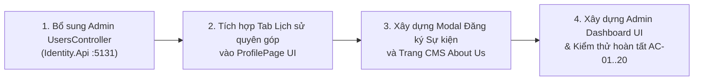

# LỘ TRÌNH PHÁT TRIỂN DỰ ÁN (PROJECT ROADMAP)
## Give-AID NGO Platform — Cổng Thông Tin & Quyên Góp Từ Thiện Trực Tuyến

> **Cập nhật:** Ngày 30/10/2026  
> **Phiên bản hệ thống:** v1.5-verified  
> **Kiến trúc:** .NET 10 Microservices + Local SQL Server 2022 Express + YARP API Gateway + React 19 (Vite & Tailwind)  
> **Trạng thái tổng thể:** **100% Backend & Security Hardening Hoàn Thành**; Toàn bộ các dịch vụ đang chạy live và bảo vệ đa tầng; Đang hoàn thiện các phân hệ nâng cao Frontend.

---

## I. TỔNG QUAN KIẾN TRÚC & CÁC DỊCH VỤ HOẠT ĐỘNG (SERVICES)

```
                            ┌───────────────────────────────────────────┐
                            │      Client Web Portal (React 19)         │
                            │      Port 5173 (Vite + Tailwind CSS)      │
                            └─────────────────────┬─────────────────────┘
                                                  │ (HTTP / JSON / JWT)
                                                  ▼
                            ┌───────────────────────────────────────────┐
                            │        API Gateway (YARP Proxy)           │
                            │        Port 5169                          │
                            │        - Xác thực JWT tập trung           │
                            │        - Chống Header Spoofing (X-User-*) │
                            │        - Phân quyền AdminOnly / User      │
                            └───────┬───────┬───────────┬───────────────┘
                                    │       │           │
        ┌───────────────────────────┘       │           └───────────────────────────┐
        ▼                                   ▼                                       ▼
┌───────────────┐                   ┌───────────────┐                       ┌───────────────┐
│ Identity.Api  │                   │ Donation.Api  │                       │  Content.Api  │
│ Port 5131     │                   │ Port 5141     │                       │  Port 5151    │
│ Scalar /v1    │                   │ Scalar /v1    │                       │  Scalar /v1   │
│ Auth, Profile,│                   │ 6 Causes CRUD,│                       │  NGOs, Prog., │
│ Occupation,   │                   │ Donate Giả lập│                       │  7 About CMS, │
│ Roles Matrix  │                   │ Tra cứu mã GD │                       │  Help Centre  │
└───────┬───────┘                   └───────┬───────┘                       └───────┬───────┘
        │                                   │ (S2S: X-Internal-Secret)              │ (S2S)
        │                                   └───────────────────┬───────────────────┘
        │                                                       ▼
        │                                           ┌───────────────────────┐
        │                                           │   Notification.Api    │
        │                                           │   Port 5121           │
        │                                           │   Scalar /v1          │
        │                                           │   MailKit SMTP Client │
        │                                           │   Internal Secret Only│
        │                                           └───────────────────────┘
        │                                                       │
        └───────────────────────────┬───────────────────────────┘
                                    ▼
                    ┌───────────────────────────────┐
                    │  Microsoft SQL Server 2022    │
                    │  Database: [IdentityDb]       │
                    │  13 Bảng, 1 View, Seed Data   │
                    └───────────────────────────────┘
```

---

## II. MA TRẬN TIẾN ĐỘ THEO GIAI ĐOẠN (ROADMAP MILESTONES)

| Giai đoạn | Trọng tâm & Deliverables | Thời gian | Trạng thái | Hoàn thành |
| :--- | :--- | :---: | :---: | :---: |
| **Milestone 1** | **Nền tảng, Database SQL Server 2022 & Identity Auth**<br>13 bảng, View `vw_DonationStatistics`, Auth JWT + Refresh Token, trường `Occupation` | 01/10 – 22/10 | 🟢 **ĐÃ HOÀN THÀNH** | **95%** |
| **Milestone 2** | **Dịch vụ Quyên góp (`Donation.Api` :5141)**<br>6 danh mục Causes, Quyên góp giả lập 10k–100tr, Luhn/Check thẻ, Tra cứu mã, Lịch sử, S2S Email | 23/10 – 30/10 | 🟢 **ĐÃ HOÀN THÀNH & LIVE** | **100%** |
| **Milestone 3** | **Dịch vụ Nội dung, NGO & Sự kiện (`Content.Api` :5151)**<br>CRUD NGO, Sự kiện (chống trùng lặp), 7 trang con About Us, Đối tác, Gallery, Help Centre | 30/10 | 🟢 **ĐÃ HOÀN THÀNH & LIVE** | **100%** |
| **Milestone 4** | **YARP Gateway Routing & Bảo vệ An ninh Toàn diện**<br>Bảo mật đa tầng, Anti-IDOR, Anti-Spam Relay, S2S Secret `X-Internal-Secret`, Header Anti-Spoofing | 30/10 | 🟢 **ĐÃ HOÀN THÀNH & TEST 100%** | **100%** |
| **Milestone 5** | **Giao diện Người dùng (React 19 Client & Admin Portal)**<br>Trang chủ, Form Donate, Help Centre, Profile cá nhân, Tra cứu lịch sử, Admin Dashboard | 30/10 – 07/11 | 🟡 **ĐANG HOÀN THIỆN** | **60%** |
| **Milestone 6** | **Kiểm thử Toàn diện E2E (20 Tiêu chí AC-01..20)**<br>Rà soát chức năng, kiểm thử kịch bản thành công/thất bại, tài chính giả lập | 08/11 – 15/11 | 🟡 **TIẾP DIỄN** | **65%** |
| **Milestone 7** | **Dữ liệu Demo, Báo cáo & Đóng gói Bàn giao** | 16/11 – 20/11 | ⚪ **KẾ HOẠCH** | **10%** |

---

## III. CHI TIẾT TỪNG GIAI ĐOẠN ĐÃ THỰC HIỆN

### 1. Milestone 1: Nền tảng, Database & Identity (95%)
- [x] **Database SQL Server 2022 (`IdentityDb`):**
  - [x] Migration 13 bảng: `AspNetUsers`, `AspNetRoles`, `Causes`, `Ngos`, `NgoCauses`, `Programmes`, `ProgrammeRegistrations`, `Donations`, `Partners`, `AboutPages`, `Galleries`, `Queries`, `QueryReplies`, `EmailInvitations`.
  - [x] Tạo View báo cáo động `vw_DonationStatistics`.
  - [x] Nạp dữ liệu mẫu (`GiveAid_SeedData.sql`): 6 Causes, 2 NGOs, 7 About pages, 2 Partners, sample Programme, Permissions hệ thống.
  - [x] Bổ sung cột `Occupation` (Nghề nghiệp) theo yêu cầu đăng ký của Give-AID.
- [x] **Dịch vụ Identity (`Identity.Api` :5131):**
  - [x] Đăng ký, Đăng nhập, Cấp JWT Access Token (1h) + Refresh Token Rotation (7 ngày).
  - [x] Quên mật khẩu, Đặt lại mật khẩu tuân thủ OWASP Anti-Account Enumeration.
  - [x] Xác thực Email & Đổi mật khẩu trong phiên.
  - [x] Hồ sơ cá nhân (`GET / PUT /api/auth/profile`).
  - [ ] *Bổ sung module Admin User Management (`UsersController`: xem danh sách thành viên, chi tiết, khóa/mở khóa tài khoản theo Q-04).*

---

### 2. Milestone 2: Dịch vụ Quyên góp (`Donation.Api` :5141) — Hoàn thành 100%
- [x] Khởi tạo .NET 10 Web API, kết nối EF Core với SQL Server, cấu hình OpenAPI Scalar (`:5141/scalar/v1`).
- [x] **Quản lý Danh mục Causes (FR-08):**
  - [x] `GET /api/donations/causes`: Trả về 6 danh mục chuẩn (Children, Education, Disabled, Women, Youth, Elderly) kèm tổng tiền gây quỹ động.
  - [x] `POST / PUT / PATCH /api/donations/causes`: Tạo, sửa, bật/tắt danh mục (Admin-only).
- [x] **Quyên góp Giả lập (FR-14..17 / Q-01, 02, 08):**
  - [x] `POST /api/donations`: Tiếp nhận đóng góp (Cho phép khách vãng lai hoặc thành viên đăng nhập).
  - [x] Kiểm tra số tiền hợp lệ: 10,000 VNĐ đến 100,000,000 VNĐ.
  - [x] Kiểm tra định dạng thẻ (16 chữ số, Luhn checksum, ngày hết hạn).
  - [x] Sinh mã giao dịch duy nhất theo mẫu: `GD-YYYYMMDD-XXXX`.
  - [x] Kịch bản thất bại: Thẻ kết thúc bằng `0000` hoặc cờ `simulateFailure: true` -> Ghi nhận `Failed`.
  - [x] Tuyệt đối không lưu CVV hoặc dãy số thẻ ngân hàng (chỉ lưu 4 số cuối `CardLastFour`).
- [x] **Tra cứu & Lịch sử (FR-17, FR-25 / Q-03):**
  - [x] `GET /api/donations/track/{transactionCode}`: Tra cứu công khai biên lai quyên góp.
  - [x] `GET /api/donations/my-history`: Lịch sử các khoản đóng góp của người dùng đăng nhập.
  - [x] `GET /api/donations/admin/stats` & `/admin/all`: Báo cáo thống kê tổng tiền, số giao dịch cho Admin.
- [x] **Tích hợp S2S Email Cảm ơn:** Tự động kích hoạt gửi email biên nhận qua `Notification.Api` khi đóng góp thành công.

---

### 3. Milestone 3: Dịch vụ Nội dung, NGO & Chương trình (`Content.Api` :5151) — Hoàn thành 100%
- [x] Khởi tạo .NET 10 Web API, kết nối EF Core, Scalar (`:5151/scalar/v1`).
- [x] **Quản lý Tổ chức NGO (FR-09 / Q-05):**
  - [x] CRUD NGO, logo, thông tin liên hệ, liên kết nhiều danh mục Causes (`NgoCauses`).
- [x] **Quản lý Sự kiện / Chương trình Thiện nguyện (FR-10, FR-21):**
  - [x] CRUD sự kiện, phân loại `Upcoming` / `Completed`, kiểm tra ngày bắt đầu/kết thúc.
  - [x] `POST /api/content/programmes/{id}/register`: Đăng ký tham gia sự kiện.
  - [x] **Cơ chế chống đăng ký trùng lặp:** Chặn người dùng hoặc email đăng ký nhiều lần cho 1 sự kiện.
  - [x] `GET /api/content/programmes/my-registrations`: Xem sự kiện bản thân đã tham gia.
- [x] **Quản trị CMS Động 7 trang con About Us (FR-04 / Q-11):**
  - [x] `what-we-do`, `our-mission`, `our-team`, `career-with-us`, `our-achievements`, `our-supporters`, `read-about-us`.
  - [x] Public đọc nội dung, Admin cập nhật (`PUT /api/content/about/{slug}`).
- [x] **Quản lý Đối tác & Thư viện ảnh (FR-05, FR-12):**
  - [x] CRUD đối tác tài trợ (`Partners`) & Thư viện ảnh (`Galleries`).
- [x] **Help Centre & Phản hồi nhiều lượt (FR-06, FR-11, FR-19):**
  - [x] Khách/User gửi thắc mắc (`POST /api/content/queries`).
  - [x] Admin trả lời (`POST /api/content/queries/{id}/reply`) -> Tự động gửi email thông báo câu trả lời cho người hỏi.
  - [x] Lịch sử câu hỏi của tôi (`GET /my-queries`).
- [x] **Mời bạn bè qua Email (FR-18):**
  - [x] Ghi nhận lời mời tham gia và kích hoạt gửi email mời thiện nguyện.

---

### 4. Milestone 4: YARP Gateway Routing & Bảo Mật Toàn Diện — Hoàn thành 100%
- [x] **Định tuyến tập trung:** Điều phối toàn bộ traffic từ cổng `:5169` vào các dịch vụ nội bộ.
- [x] **Bảo vệ IDOR tại Help Centre:** Endpoint `GET /api/content/queries/{id}` chỉ cho phép Admin hoặc chính chủ sở hữu xem, trả về `403 Forbidden` đối với người khác.
- [x] **Chống Spam Email Relay:** Endpoint `POST /api/content/invitations` bắt buộc đăng nhập `[Authorize]`.
- [x] **Bảo vệ Nội bộ Service-to-Service (S2S):** Cài đặt `InternalSecretMiddleware` trên `Notification.Api` với khóa `X-Internal-Secret: eProject_Internal_Secret_Key_2026_Secure!`. Chặn đứng `401 Unauthorized` nếu gọi trực tiếp bên ngoài.
- [x] **Chống giả mạo Header danh tính (Anti-Header Spoofing):** YARP tự động gỡ bỏ các header `X-User-Id`, `X-User-Roles`, `X-User-Email` do client gửi lên.
- [x] **Khóa route Notification trên Gateway:** Áp dụng policy `AdminOnly`.
- [x] **Kiểm thử tự động:** Vượt qua 100% các bài test bảo mật phân quyền (Admin 200, User 403, No-Auth 401, Public 200).

---

### 5. Milestone 5: Giao diện Người dùng (React Client & Admin) — Đang triển khai (60%)
- [x] **Trang chủ (`HomePage.tsx`):**
  - [x] Header Neoclassical sang trọng với đầy đủ 6 menu SRS.
  - [x] Hero Section với slogan kêu gọi và nút Donate.
  - [x] Impact Statistics tải dữ liệu động từ backend.
  - [x] Our Causes hiển thị 6 danh mục từ `donationService`.
  - [x] About Us, Featured Programmes, Why Choose Us, Our Partners, Gallery, CTA.
  - [x] Help Centre Contact Form gửi thắc mắc trực tiếp vào `contentService.submitQuery`.
  - [x] Footer Section & Đăng ký nhận tin.
- [x] **Trang Quyên góp (`DonatePage.tsx`):**
  - [x] Chọn danh mục Cause từ backend.
  - [x] Chọn số tiền định mức (50k, 100k, 200k, 500k, 1tr, 2tr) hoặc nhập tùy ý.
  - [x] Form thẻ thanh toán giả lập với kiểm tra hợp lệ.
  - [x] Xử lý kịch bản thành công / thất bại, trả về mã giao dịch `GD-...` và modal biên lai.
- [x] **Trang Xác thực (`LoginPage`, `RegisterPage`, `ForgotPassword`, `ResetPassword`, `Profile`):**
  - [x] Hỗ trợ nhập trường nghề nghiệp (`Occupation`) khi đăng ký.
  - [x] Xem thông tin hồ sơ và đổi mật khẩu an toàn.
- [ ] **Các hạng mục Frontend tiếp theo:**
  - [ ] Bổ sung tab *"Lịch sử Quyên góp"* (`/donations/my-history`) & *"Sự kiện đã đăng ký"* trong trang Profile.
  - [ ] Modal đăng ký tham gia sự kiện thiện nguyện từ danh sách Programmes.
  - [ ] Màn hình chi tiết xem 7 trang About Us CMS động.
  - [ ] Giao diện Quản trị viên (Admin Portal) quản lý Causes, NGOs, Programmes, duyệt câu hỏi Help Centre.

---

## IV. BƯỚC HÀNH ĐỘNG TIẾP THEO ƯU TIÊN



1. **Bổ sung `UsersController` trong `Identity.Api`:** Cung cấp API xem danh sách thành viên, chi tiết và khóa/mở khóa tài khoản cho Admin (hoàn tất 100% Milestone 1).
2. **Nâng cấp trang Profile Người dùng:** Thêm tab hiển thị lịch sử các khoản quyên góp cá nhân và sự kiện thiện nguyện đã tham gia.
3. **Mở rộng tương tác Sự kiện & CMS:** Thêm modal đăng ký tham gia trực tiếp cho khách và thành viên trên trang chủ/sự kiện.
4. **Hoàn thiện giao diện Admin Portal:** Dashboard thống kê dòng tiền và các bảng quản trị nội dung.